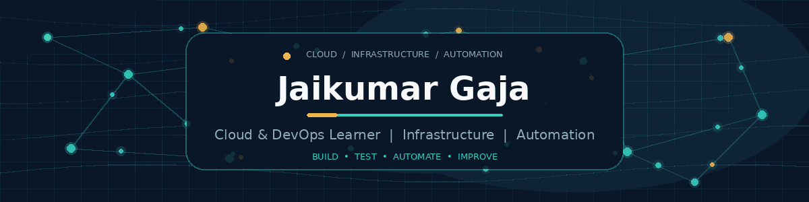

  

  <strong>Cloud Infrastructure · Automation · Continuous Learning</strong>

  
  
  

  

---

## 👋 About Me

I'm an **Information Technology graduate** building practical skills in cloud infrastructure and DevOps. At Accenture, I supported users of the X Ads dashboard by reproducing issues, troubleshooting account-access and payment workflows, documenting cases, and escalating complex problems through Jira while working to SLA requirements.

I'm now focused on turning that troubleshooting mindset into hands-on cloud and infrastructure skills. I value understanding why a system works, testing changes carefully, and documenting what I learn—not just collecting tools or certificates.

## 🎯 Current Focus

- **Linux & networking:** command-line troubleshooting, processes, logs, DNS, ports, and HTTP/HTTPS.
- **AWS:** EC2, IAM, VPC, networking, and EKS fundamentals.
- **Containers & orchestration:** Docker, Kubernetes resources, deployments, and troubleshooting.
- **Infrastructure & delivery:** Terraform, GitHub Actions, CI/CD workflows, and GitOps concepts with Argo CD.
- **Engineering habits:** small experiments, reading documentation, testing changes, and explaining technical decisions clearly.

---

## 🚀 Featured Project

### [Cloud-Native DevOps Portfolio Project](https://github.com/JaikumarGaja/devops-portfolio-project)

A hands-on portfolio project exploring how to provision cloud infrastructure with Terraform and evolve a containerised application deployment toward **Amazon EKS and GitOps with Argo CD**.

  
  
  
  
  
  

**What it explores**

- Defining AWS infrastructure and EKS resources with Terraform.
- Using Kubernetes Deployments and Services to run application components.
- Bootstrapping Argo CD and exploring GitOps-based application synchronisation.
- Working with CI/CD workflows, configuration, and application secrets.
- Documenting infrastructure issues, troubleshooting steps, security considerations, and cloud-cost trade-offs.

This is a **learning and portfolio project**, not a claim of production engineering experience. Visit the repository for the current implementation, setup notes, known limitations, and project history.

  

---

## 🧰 Technical Toolkit

I separate technologies I have used in project work from the fundamentals I am actively strengthening.

### Project exposure

  

| Area | Technologies / experience |
|---|---|
| Cloud & infrastructure | AWS (EC2, VPC, IAM, EKS), Terraform — portfolio-project exposure |
| Containers | Docker, Docker Compose, Kubernetes fundamentals |
| CI/CD & GitOps | Git, GitHub Actions, Jenkins (earlier project phase), Argo CD exploration |
| Application components | Node.js / React and MongoDB Atlas in the portfolio project |
| Support & troubleshooting | Issue reproduction, ticket documentation, Jira escalations, SLA-focused support |

### Currently strengthening

  

Linux command-line troubleshooting, networking fundamentals, AWS IAM and VPC concepts, Terraform state and plans, Kubernetes debugging, CI/CD workflows, and clear technical communication.

---

## 💼 Background

- **Accenture — Customer Support Representative** · January–June 2024 (actual dates: 9 January–4 June). Supported X Ads users, reproduced reported issues, helped with account and payment workflows, and escalated complex cases through Jira under SLA requirements.
- **Independent contract work — AI data evaluation / quality review** · Project-based assignments through CrowdGen and Outlier AI during 2025–2026.

## 🎓 Education & Certification

- **B.Sc. in Information Technology** — SIES College of Arts, Science and Commerce, 2023 · CGPA: 9.25/10.
- **DevOps Certification** — TuteDude, September 2026.

---

## 📬 Connect

I'm interested in entry-level opportunities in **Cloud Support, Infrastructure Support, and Junior DevOps**, and in learning from engineers who value troubleshooting, clear documentation, and continuous improvement.

- **GitHub:** [JaikumarGaja](https://github.com/JaikumarGaja)
- **Featured project:** [DevOps Portfolio Project](https://github.com/JaikumarGaja/devops-portfolio-project)
- **LinkedIn / professional email:** Add your preferred public links here before publishing.

<!-- Optional: add a LinkedIn badge and mailto badge once you have confirmed the exact URLs. -->

  

  Building practical skills, one project at a time.

